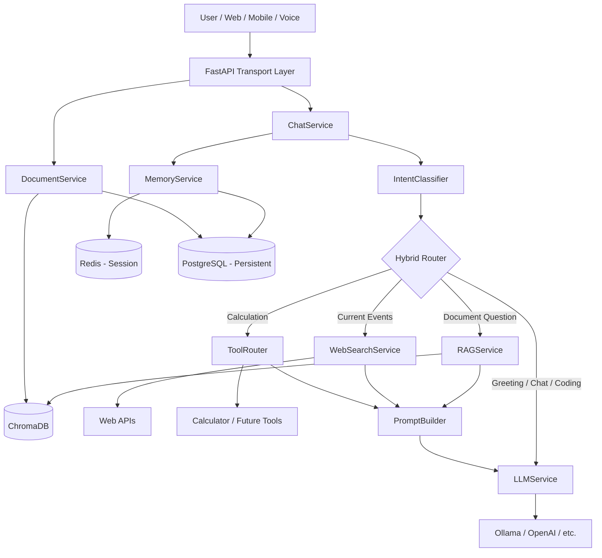

# GTS Hybrid AI Assistant

An intelligent multi-user AI assistant with hybrid routing — general conversation, document intelligence (RAG), web search, and tool support. Built with FastAPI, Ollama, ChromaDB, Redis, and PostgreSQL.

## Architecture



### Hybrid Routing Flow

```
User Question
    ↓
Intent Detection (IntentClassifier)
    ↓
Need Documents?  ──YES──► ChromaDB Search (with similarity threshold)
    │ NO
    ↓
Need Internet?   ──YES──► Web Search (DuckDuckGo / Tavily)
    │ NO
    ↓
Need Tools?      ──YES──► Tool Router (Calculator, etc.)
    │ NO
    ↓
Prompt Builder (dynamic — context only when relevant)
    ↓
LLM Service (Ollama / configurable provider)
    ↓
Response (streaming or JSON)
```

## Quick Start

```bash
docker compose up -d
cd app && python3 -m venv venv && source venv/bin/activate
pip install -r requirements.txt
cp ../.env.example .env
python data_ingest.py   # optional
ollama pull llama3 && ollama serve
uvicorn main:app --reload --port 8000
```

Open http://localhost:8000

## API Endpoints

| Endpoint | Method | Description |
|----------|--------|-------------|
| `/chat` | POST | Send message (JSON) |
| `/chat/stream` | POST | Send message (SSE streaming) |
| `/documents/upload` | POST | Upload PDF/DOCX/TXT/CSV |
| `/documents/{user_id}` | GET | List uploaded documents |
| `/users`, `/session`, `/history`, `/clear`, `/health` | | Unchanged |

See `.env.example` for all configuration options.
